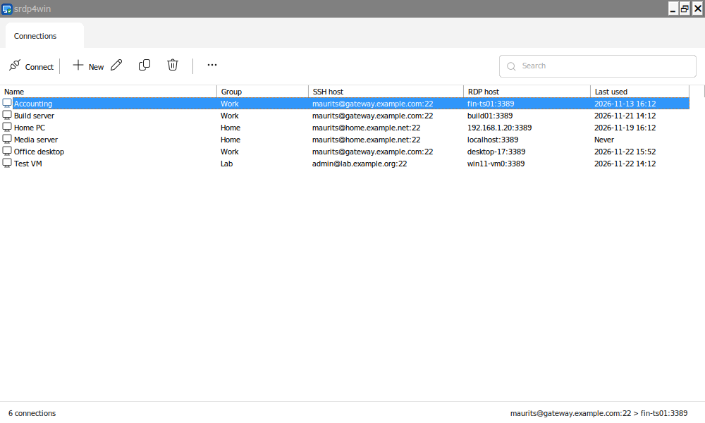

# srdp4win

A remote desktop client for Windows that only connects through SSH, written in
Go with [Windigo](https://github.com/rodrigocfd/windigo).



A connection has two addresses: the SSH host to log in to and the RDP host to
reach from there. srdp4win logs in, opens a tunnel and shows the remote desktop
in a tab. The RDP port never has to be reachable from the internet: only SSH
is. The session itself is Microsoft's own RDP client (the engine of
`mstsc.exe`) inside the window, so it is as fast and complete as the real
thing.

## Features

- **No direct RDP:** every session goes through the SSH tunnel. There is no
  setting, flag or fallback that skips it, and a connection without an SSH
  host cannot be saved.
- **Connection manager:** the app starts with your list of connections, with
  groups and a search box. Double-click one to open it in a new tab.
- **SSH login** with the Windows OpenSSH agent, Pageant, a key file or a
  password (keyboard-interactive too). Host keys are checked against
  `~/.ssh/known_hosts`: an unknown key is shown with its fingerprint to trust,
  a changed key is refused. SSH passwords and key passphrases are never
  stored.
- **Saved RDP password:** optional, and encrypted with DPAPI so only your
  Windows account can read it. The password is handed to the session, so
  network level authentication works without another prompt.
- **Clipboard:** copy and paste text, images and files between both desktops.
- **Printers:** print from the remote desktop on your local printers.
- **Font smoothing:** ClearType text, and a picture that is 1:1 and sharp at
  any display scaling.
- **Dynamic resizing:** the remote desktop follows the size of the window.
  It can also be stretched to the window or kept at a fixed resolution, and
  you can switch while connected.
- **Full screen** with a toolbar that slides down from the top edge of the
  screen and hides itself again, or stays when pinned: leave full screen,
  resize mode, switch tabs, send keys such as Ctrl+Alt+Del, take a screenshot,
  minimize and disconnect.
- **Reconnects** by itself when the SSH link drops.
- **Per connection options:** drives, sound, smart cards, Windows key
  combinations, quality preset, colour depth, admin session.
- **Feels like home:** a Windows 11 style window with tabs, light or dark like
  the rest of Windows.
- **Nothing to install on the server:** any OpenSSH server that allows TCP
  forwarding (`AllowTcpForwarding`) and any RDP server it can reach: Windows,
  xrdp or GNOME Remote Desktop.

The RDP session runs over TCP only, because UDP cannot pass through an SSH
tunnel. Spanning several monitors is not supported.

## Get started

You need to be on Windows 11. Install `srdp4win-<version>-amd64.msi` from the
[releases](https://github.com/mevdschee/srdp4win/releases). It installs for
your user only, in `%LOCALAPPDATA%\Programs\srdp4win`, and does not need admin
rights. srdp4win itself never asks for them either. The installer is not
signed, so Windows SmartScreen may ask you to confirm ("More info", "Run
anyway").

Run srdp4win from the Start menu and add a connection:

- **SSH host:** the server you can log in to, with your user name there.
- **RDP host:** the computer to control, as seen from the SSH host. Enter
  `localhost` when it is the SSH host itself.

Double-click the connection to open it. Use "Check for updates" in the "..."
menu to get new versions.

## Data

Connections are saved in `%APPDATA%\srdp4win\connections.dat`, encrypted with
DPAPI as a whole so only the current Windows user can read them. Settings are
in `settings.json` and the log in `srdp4win.log` next to it. The log never
contains passwords.

## Build (on Linux)

```
sudo apt install wine jq wixl msitools gh
go install github.com/tc-hib/go-winres@latest
go test ./...              # the plain Go parts, on Linux
GOOS=windows go vet ./...  # the Windows parts, at compile level
./run.sh                   # build srdp4win.exe and run it with Wine
./release.sh [minor]       # build the MSI and publish a GitHub release
```

There is no cgo and no bundled DLL: the result is a single `srdp4win.exe`.
The icon, manifest (visual styles, per-monitor DPI awareness, no elevation)
and version info are compiled from `winres/` into a `.syso` file, which is not
committed. The app icon is `internal/icons/app/icon.svg`, rendered into `winres/` by `go run ./tools/genicon` (needs Inkscape). The
installer is defined in `installer/srdp4win.wxs`.

## Testing under Wine

Wine has no working RDP control, so the session sits behind a small interface
with two implementations: the real control and a fake one. The fake session
draws a panel instead of the remote desktop. It opens the SSH tunnel like the
real one, sends a minimal RDP connection request through it and shows what the
RDP server answers, which proves the whole SSH path works. It reports the same
events as the real session and shows its state, size, scale and resize mode as
text.

srdp4win uses the fake session by itself when the RDP control is missing, as
under Wine, and on Windows when started with `--fake`:

```
./run.sh           # under Wine: always the fake session
srdp4win.exe --fake
```

That makes everything except the live picture testable on Linux: the
connection manager, SSH login and host key prompts, the tunnel, tabs, the
toolbar, the resize logic, full screen with the sliding toolbar, settings,
themes and the updater. The live picture, printers, clipboard and font
smoothing need a real Windows machine. Wine keeps its own `%APPDATA%`, so
what you add there stays apart from a real install.

## License

MIT. Icons from
[Fluent UI System Icons](https://github.com/microsoft/fluentui-system-icons)
(MIT).
